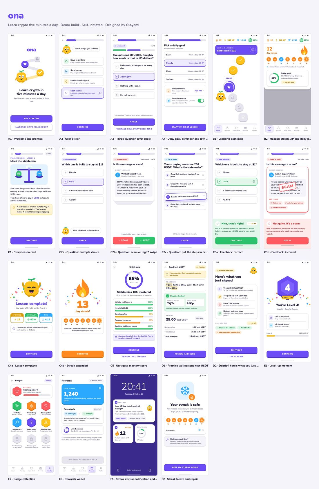

# Ona — learn crypto five minutes a day

Learn crypto five minutes a day, and learn to spot a scam before it finds you.

**Live demo:** https://ona-demo.sites.tab.bot/

Demo build · Self-initiated project · Designed by Olayemi



## What it is

An Android-first learning app for crypto beginners: short daily lessons, a “scam or legit?” challenge, a practice wallet, streaks, XP and badges. One full unit, Stablecoins 101 (five lessons), is designed end to end; the rest of the learning path is shown locked.

Reward amounts in the screens are examples. Nothing here is a real token to buy, and nothing here is financial advice.

## Screens

22 screens, each a fixed 390 × 844 artboard at its own address:

- **Onboarding:** welcome, goal picker, three-question level check, daily goal with reminder and low-data mode
- **Home:** learning path map; header with streak, XP and daily goal ring
- **Lesson loop:** story card; multiple choice, “scam or legit?” swipe and put-the-steps-in-order questions; correct and incorrect feedback with a one-line why; lesson complete; streak extended; unit quiz with mastery score
- **Practice sandbox:** send test USDT in a practice wallet; “here’s what you just signed” debrief
- **Rewards and progression:** level-up moment, badge collection, rewards wallet
- **Re-engagement:** streak at risk notification and widget; streak freeze and repair

Add `?figma=1` to any screen’s address to switch the motion off, e.g. for a clean import into Figma with html.to.design.

## Run locally

The pages are plain static HTML, CSS and a little JavaScript. Serve the `site/` folder with any static server:

```
cd site
python3 -m http.server 8000
```

Then open http://localhost:8000.

## Rebuild

Every page is generated by `tools/build.py` (Python 3, no dependencies):

```
python3 tools/build.py
```

It writes `site/index.html` and `site/s/<screen>/index.html`. Shared styles live in `site/assets/ona.css` and interactions in `site/assets/ona.js`.

## Structure

- `site/` the built pages, styles, script, icons and font
- `tools/build.py` the generator for every page
- `docs/preview.jpg` the overview image above

## License

All rights reserved. © Jola Olayemi. Nunito is under the SIL Open Font License and Line Awesome icons under their own license (see `site/assets/fonts/OFL.txt` and `site/assets/icons/LICENSE.txt`).
